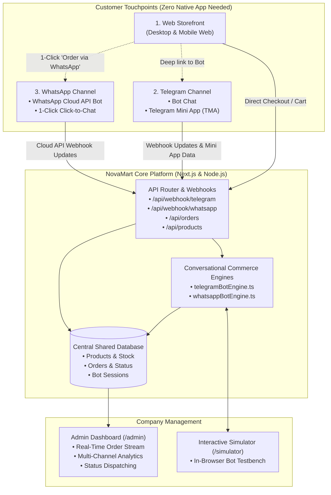

# NovaMart — Omnichannel Web, Telegram & WhatsApp E-Commerce Platform

> **Business Strategy:** Instead of spending 4–6 months and tens of thousands of dollars building and maintaining native iOS and Android Mobile Apps, this solution connects **Telegram** and **WhatsApp** directly to the company website and central database. Customers can purchase orders normally in the messaging apps they already have on their phones.

---

## 🌟 Key Benefits of This Architecture

| Metric | Traditional Native Mobile App | Our Telegram & WhatsApp Integration |
| :--- | :--- | :--- |
| **Time to Market** | 3 – 6 Months (Swift + Kotlin + backend) | **Instant / Days** (Single fullstack codebase) |
| **App Store Friction** | Customers must download 100MB+ from App Store | **Zero Friction** (Users already have Telegram & WhatsApp open) |
| **App Store Approval** | 1 – 2 weeks review delay for every update | **Instant Continuous Deployment** |
| **Store Commissions** | 15% – 30% Apple / Google in-app payment fee | **0% Platform Fee** (Direct payment / COD / Bank transfer) |
| **Notification Read Rate** | ~2% – 5% push notification open rate | **~98% message open rate** in WhatsApp & Telegram |
| **Codebase Maintenance** | 3 codebases (Web, iOS, Android) | **1 unified fullstack system** |

---

## 🏗️ System Architecture



---

## 🚀 Key Features

### 1. Web Storefront (`/`)
- Responsive product catalog with real-time stock and category filtering.
- **"1-Click Order via WhatsApp"** button on every product card and cart drawer.
- **"Order via Telegram"** deep-link button to open the Telegram bot or Mini App.
- Standard web checkout option with Cash on Delivery (COD) or Bank Transfer.

### 2. Telegram Integration (`/telegram-app` & `/api/webhook/telegram`)
- **Telegram Mini App (TMA)**: A native-like in-app webview store running right inside Telegram via Telegram WebApp SDK (`window.Telegram.WebApp`).
- **Telegram Bot Ordering Flow**:
  - `/start`: Interactive welcome menu with inline keyboard buttons.
  - `/catalog`: Browse products with instant "Buy" inline buttons.
  - Conversational checkout: Collects item quantity, recipient name, phone, and delivery address.
  - Automatic order generation with real-time order tracking (`/status ORD-XXXXX`).

### 3. WhatsApp Integration (`/api/webhook/whatsapp`)
- **Meta WhatsApp Cloud API Webhook**:
  - `GET` verification handshake (`hub.mode`, `hub.verify_token`, `hub.challenge`).
  - `POST` message processor handling incoming chat orders.
- **Conversational Purchasing**:
  - Sends catalog upon receiving `CATALOG`, `MENU`, or `HI`.
  - Direct quick-buy syntax: `BUY 1` or `BUY 2`.
  - Prompts for quantity, shipping name, and delivery address.
  - Finalizes order and responds with an official digital receipt.
- **WhatsApp Click-to-Chat Deep Linking**:
  - Generates pre-formatted `https://wa.me/<number>?text=...` links so mobile website visitors can push their entire cart directly into WhatsApp with 1 tap.

### 4. Unified Admin Portal (`/admin`)
- Central order dashboard consolidating orders from **Web**, **Telegram**, and **WhatsApp**.
- Channel performance breakdown (% share and gross revenue by channel).
- Real-time order status updates: `CONFIRMED` ➔ `PROCESSING` ➔ `SHIPPED` ➔ `DELIVERED`.

### 5. Interactive Chatbots Simulator (`/simulator`)
- A browser-based test bench with side-by-side Telegram and WhatsApp client mockups.
- Allows team members, graders, and clients to test conversational checkout flows without needing live API tokens upfront.

---

## 💻 Quick Start & Running Locally

### 1. Installation
```bash
npm install
```

### 2. Running the Development Server
```bash
npm run dev
```
Open **[http://localhost:3000](http://localhost:3000)** (or port 3005 if port 3000 is occupied).

### 3. Running Production Build
```bash
npm run build
npm run start -- -p 3005
```

---

## ⚙️ Connecting Live Telegram & WhatsApp Credentials

Copy `.env.example` to `.env.local`:
```bash
cp .env.example .env.local
```

### Telegram Bot Setup:
1. Message **@BotFather** on Telegram and create a bot (`/newbot`).
2. Copy the bot token to `TELEGRAM_BOT_TOKEN` in `.env.local`.
3. Set your webhook URL:
   ```bash
   curl -F "url=https://your-domain.com/api/webhook/telegram" https://api.telegram.org/bot<YOUR_TELEGRAM_TOKEN>/setWebhook
   ```

### WhatsApp Cloud API Setup:
1. Create an app in the [Meta for Developers Portal](https://developers.facebook.com/).
2. Add **WhatsApp Product** and configure your test phone number.
3. Configure the Webhook:
   - **Callback URL:** `https://your-domain.com/api/webhook/whatsapp`
   - **Verify Token:** matching `WHATSAPP_VERIFY_TOKEN` (default: `novamart_whatsapp_secret_token`)
   - **Subscribed Fields:** `messages`

---

## 📁 Project Structure

```
├── data/
│   └── db.json                    # Central JSON database (Products, Orders, Bot Sessions)
├── src/
│   ├── app/
│   │   ├── page.tsx               # Web Storefront & Business Comparison
│   │   ├── admin/page.tsx         # Unified Multi-Channel Admin Dashboard
│   │   ├── simulator/page.tsx     # Telegram & WhatsApp Chatbot Simulator
│   │   ├── telegram-app/page.tsx  # Native-feel Telegram Mini App (TMA)
│   │   ├── api/
│   │   │   ├── products/route.ts  # Catalog API
│   │   │   ├── orders/route.ts    # Orders CRUD & Status API
│   │   │   ├── webhook/
│   │   │   │   ├── telegram/route.ts # Live Telegram Webhook Handler
│   │   │   │   └── whatsapp/route.ts # Live Meta WhatsApp Webhook Handler
│   │   │   └── simulate/
│   │   │       ├── telegram/route.ts # Simulator Telegram Engine
│   │   │       └── whatsapp/route.ts # Simulator WhatsApp Engine
│   │   ├── globals.css            # Tailwind styles
│   │   └── layout.tsx             # Global layout & Omnichannel Navbar
│   ├── components/
│   │   ├── Navbar.tsx             # Header with channel links & cart trigger
│   │   └── CartDrawer.tsx         # Cart drawer with WhatsApp & Telegram 1-click checkout
│   ├── context/
│   │   └── CartContext.tsx        # Client cart state & persistence
│   └── lib/
│       ├── types.ts               # TypeScript schemas
│       ├── db.ts                  # Shared persistence & inventory management
│       ├── telegramBotEngine.ts   # Telegram conversational ordering engine
│       └── whatsappBotEngine.ts   # WhatsApp conversational ordering engine
└── package.json
```

---

## 🧪 Verification & Automated Testing

You can test all endpoints directly using `curl`:

```bash
# 1. Fetch products
curl -s http://localhost:3005/api/products

# 2. Test WhatsApp Webhook Verification Handshake
curl -s "http://localhost:3005/api/webhook/whatsapp?hub.mode=subscribe&hub.verify_token=novamart_whatsapp_secret_token&hub.challenge=test_123"

# 3. Simulate Telegram bot /start
curl -s -X POST http://localhost:3005/api/simulate/telegram \
  -H "Content-Type: application/json" \
  -d '{"userId":"test_user","userName":"Alex","text":"/start"}'

# 4. View all orders from all channels
curl -s http://localhost:3005/api/orders
```
